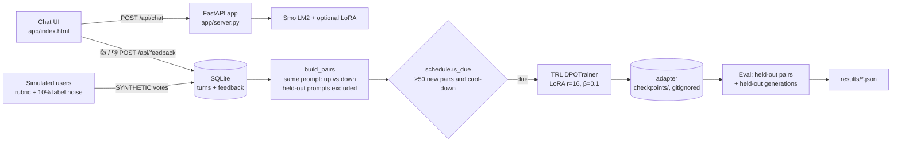

# dpo-feedback-flywheel

A feedback flywheel for a small chat model: a tiny chat app collects thumbs-up/down, ratings become DPO preference pairs, a scheduled job fine-tunes a LoRA adapter with TRL's `DPOTrainer`, and an evaluation compares base vs fine-tuned on held-out preference pairs and held-out generations. Runs on a laptop (SmolLM2-135M-Instruct on Apple MPS).

**Data label: all feedback here is SYNTHETIC** — simulated users scored by a written rubric ([`flywheel/rubric.py`](flywheel/rubric.py)), not real people.

## Why
Thumbs in a chat UI are the cheapest preference signal a product has. The hard parts are plumbing and honesty: turning sparse votes into clean pairs, keeping eval prompts out of training, deciding *when* to retrain, and checking whether the model actually changed on held-out data rather than on the training signal.

## Architecture


## How it works
- **Store** ([`flywheel/store.py`](flywheel/store.py)): SQLite `turns` + `feedback`; latest vote on a turn wins; every turn is tagged `human` or `synthetic`.
- **Pairs** ([`flywheel/pairs.py`](flywheel/pairs.py)): group by normalised prompt; each up-voted reply × each down-voted reply → `(chosen, rejected)`, capped per prompt, identical texts skipped, held-out prompts excluded; exported in TRL's conversational format.
- **Synthetic feedback** ([`flywheel/synth.py`](flywheel/synth.py)): 113 templated prompts (capitals, definitions, arithmetic, unit conversion) split 85 train / 28 held-out with disjoint entities. Each train prompt gets 3 templated replies (direct / sycophantic-padded / hedging) **plus the base model's own greedy and sampled replies** (the on-policy part of the flywheel). The simulated-user rubric: thumbs-up only if ≤40 words, no sycophantic opener ("Great question!", "Sure!"…) and no filler sign-off; 10% of votes are flipped as label noise.
- **Schedule** ([`flywheel/schedule.py`](flywheel/schedule.py)): retrain only when ≥50 new pairs arrived **and** a cool-down passed; state in a JSON file. Run it from cron, e.g. `0 */6 * * * cd /path && .venv/bin/python scripts/run_flywheel.py`.
- **Train** ([`flywheel/train.py`](flywheel/train.py)): TRL 1.17 `DPOTrainer`, implicit reference model (adapter disabled), LoRA on q/k/v/o.
- **Eval** ([`flywheel/evaluate.py`](flywheel/evaluate.py)):
  1. *Templated held-out pairs* (56): length-normalised log-prob accuracy, chosen vs rejected.
  2. *On-policy held-out pairs* (12): chosen = direct answer, rejected = the **base model's own** greedy reply where it failed the rubric. Harder, because the base model prefers its own outputs.
  3. *Held-out generations* (28 prompts, greedy): rubric pass rate, word count, and whether the gold answer appears.

## Results
One completed run: [`results/run_smollm2-135m_seed0.json`](results/run_smollm2-135m_seed0.json) (Apple silicon, MPS, torch 2.15, 2026-11-09). Feedback: 425 synthetic turns (255 templated + 170 model-generated), 194 up / 231 down, 44 votes flipped by noise → **305 training pairs**. Training: 78 steps, 2 epochs, lr 5e-5, final train loss 0.485, 191 s.

| Metric (held-out) | Base | After DPO |
|---|---|---|
| Templated pairs, length-norm. log-prob accuracy (n=56) | 0.946 | 0.964 |
| Templated pairs, DPO implicit-reward accuracy | – | 1.000 (mean margin 1.81) |
| On-policy pairs, length-norm. log-prob accuracy (n=12) | 0.083 | 0.167 |
| On-policy pairs, DPO implicit-reward accuracy | – | 0.500 (mean margin 0.07) |
| Generations: rubric pass rate (n=28) | 0.571 | **0.464** |
| Generations: mean words | 41.5 | 43.5 |
| Generations: gold answer present (n=23) | 0.652 | 0.739 |
| Generations: sycophantic opener rate | 0.000 | 0.000 |

**Reading — this run did not achieve the goal.** DPO learned the *pair* signal (implicit-reward accuracy 1.00 on templated held-out pairs; training reward accuracy rose to 0.7–0.9) but it did **not** change held-out generation behaviour in the wanted direction: rubric pass rate fell 0.571 → 0.464 (that is 16 → 13 of 28 prompts) and replies did not get shorter. Two facts explain most of it:
- SmolLM2-135M-Instruct **never** uses sycophantic openers (0/28 at baseline), so most templated pairs teach it to avoid something it does not do; the only real failure is rambling on unit conversions.
- The on-policy pairs that target that failure are a minority of the 305, and 78 steps at lr 5e-5 barely moved them (on-policy implicit-reward accuracy 0.50).

Gold-answer rate went up (0.652 → 0.739) but with n=23 that is 15 → 17 prompts and within noise.

A second run (lr 2e-4, 3 epochs, 117 steps, final train loss 0.220) finished training but its evaluation was cut off when the GPU was shared with another job; it has **no result file and no claimed numbers**. The `data/*.jsonl` pair files were rewritten by that run with the same seeds (305 / 56 / 12 rows, same counts as run 1).

## Tests
14 offline tests (`pytest`, no model download): store votes and validation, pair building (needs up+down, normalisation, held-out exclusion, cap), JSONL round-trip, rubric, synthetic split disjointness and held-out pair validity, synthetic labels and noise, on-policy held-out pairs, schedule gate and state round-trip, eval metrics, and the chat app's chat → feedback → stats flow.

```bash
/opt/homebrew/bin/python3.14 -m venv .venv
.venv/bin/pip install torch transformers trl peft datasets accelerate pytest fastapi uvicorn httpx
.venv/bin/python -m pytest -q                                   # 14 tests
.venv/bin/python scripts/run_flywheel.py --force                # full run, ~5 min on MPS
.venv/bin/python -m app.server                                  # chat app on 127.0.0.1:8000 (ADAPTER=checkpoints/run/adapter for DPO)
```

## Limits
- Synthetic feedback with a rule-based "user"; real users disagree, are sparse and drift.
- One seed, one completed configuration, 28 held-out prompts: no confidence intervals.
- No ORPO comparison was run (TRL supports it; not wired in).
- The rubric rewards brevity; a production flywheel would need a quality guard so DPO does not trade correctness for length.
- Adapters and checkpoints are gitignored; no weights are committed.

## License
MIT
